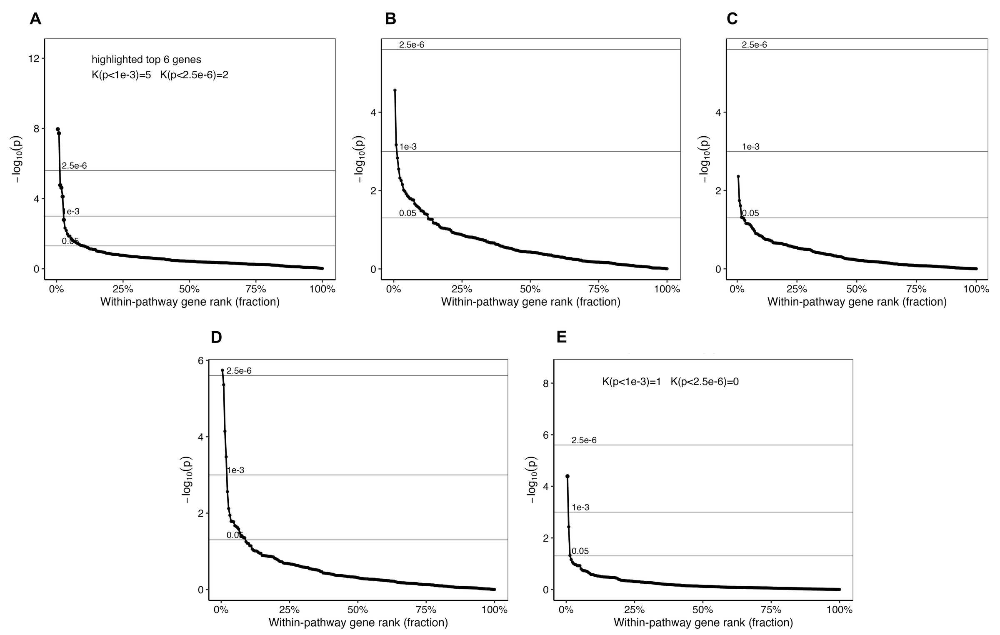

# CATFISH

**CATFISH** (Combining **C**auchy combination test (ACAT), **A**daptive **T**Fisher, **F**isher's method, m**I**n-P, and **S**touffer's method for **H**olistic pathway analysis) is an R package for post-GWAS pathway analysis. It takes MAGMA gene-level results, scores every pathway with five complementary tests combined into one omnibus, and calibrates the omnibus with a Westfall--Young procedure that accounts for gene--gene correlation and controls the family-wise error rate across pathways. It then ranks candidate genes by combining SNP-, gene- and pathway-level evidence.

## What CATFISH does

- Runs five pathway tests on gene-level GWAS statistics (ACAT, Fisher, adaptive soft TFisher, minP, Stouffer) and combines them with ACAT into an omnibus.
- Calibrates the omnibus against a genome-wide correlated null: each null replicate draws one vector of gene z-scores, chromosome by chromosome, from the MAGMA gene--gene correlations, and scores every pathway on that same draw. This gives each pathway a calibrated p-value and a Westfall--Young family-wise p-value.
- Works in log space, so gene p-values far below 1e-300 keep their order.
- Applies gene-level genomic control: the gene z-scores of each GWAS are centred at their median before testing, because a GWAS can carry a genome-wide shift that the correlated null does not contain.
- Wraps MAGMA (annotation and gene analysis, per chromosome) and reads its output back.
- Ships pathways for maize, sorghum, arabidopsis, PlantCyc, *Drosophila* and human (HumanCyc, Reactome), and reads GMT, BioCyc and PMN files.
- Ranks candidate genes with `gene_prioritize()`.

## Pathway signal archetypes

Different pathway signal shapes favour different tests, and the shape of a real pathway's signal is unknown, so CATFISH runs all five and lets the omnibus pick up signal whatever its shape.

| Archetype | Abbrev | Gene-level p-value pattern | Best methods |
|-----------|--------|---------------------------|-------------|
| Strong Sparse Signal | **SSS** | Few genes with extremely small p-values; most near null | ACAT, minP |
| Moderate Dense Signal | **MDS** | Many genes with modest consistent signal, no dominant gene | Fisher, Stouffer, soft TFisher |
| Weak Diffuse Enrichment | **WDE** | Subtle pathway-wide shift; few or none individually significant | Stouffer, Fisher |
| Mixed Signal Architecture | **MSA** | One/few strong drivers plus broader moderate support | soft TFisher, Fisher, ACAT |
| Single-Gene Proxy | **SGP** | One dominant gene; rest near null | minP, ACAT *(interpret cautiously)* |



*Within-pathway gene -log10(p), ranked from strongest to weakest, for the five archetypes: (A) Strong Sparse Signal, (B) Moderate Dense Signal, (C) Weak Diffuse Enrichment, (D) Mixed Signal Architecture, (E) Single-Gene Proxy. Horizontal lines mark representative significance thresholds.*

## Installation

### 1) MAGMA (external)

Download MAGMA from https://ctg.cncr.nl/software/magma. It is needed for the MAGMA steps only; the pathway and gene-ranking functions run without it.

### 2) CATFISH

One command installs CATFISH and everything it needs:

```r
install.packages("remotes")
remotes::install_github("nirwan1265/CATFISH")
```

R packages list their dependencies in the `DESCRIPTION` file, R's equivalent of a `requirements.txt`, and `install_github()` reads it. The required packages are installed automatically: ACAT (from GitHub, via the `Remotes` field), TFisher and data.table (from CRAN).

**Optional packages** add features to some functions; CATFISH runs without them:

| Package | Source | Used for |
|---|---|---|
| metap | CRAN | minP via `metap::minimump` in `catfish_minp_pathways()` |
| evir | CRAN | GPD tail extrapolation (`tail_mode = "hybrid_gpd"`) in `catfish_omni2_pathways()` |
| qvalue, IHW | Bioconductor | Storey q-values and IHW in `catfish_omni2_pathways()` (falls back to BH / NA) |
| rtracklayer, GenomicRanges, S4Vectors | Bioconductor | GFF3 import in `get_gene_lengths()` (otherwise a built-in reader is used) |

To install all of them:

```r
install.packages(c("metap", "evir", "BiocManager"))
BiocManager::install(c("qvalue", "IHW", "rtracklayer", "GenomicRanges", "S4Vectors"))
```

### 3) MAGMA path

```r
library(CATFISH)
options(magma.path = "/absolute/path/to/magma")
magma_path()
```

## Tutorial

The full tutorial, with every function and all of its parameters, is in [`tutorial/CATFISH_tutorial.md`](tutorial/CATFISH_tutorial.md) (also as [PDF](tutorial/CATFISH_tutorial.pdf)). The vignette (`vignette("catfish-workflow", package = "CATFISH")`) has a version that runs on simulated data in a few seconds.

## Everything in one call

`catfish_run()` goes from GWAS summary statistics, or from MAGMA output you already have, to pathway results and candidate genes:

```r
res <- catfish_run(
  gwas_file      = "data/gwas.tsv",
  rename_columns = c(CHR = "chr", SNP = "rs", POS = "ps", PVALUE = "p_wald", NMISS = "n_miss"),
  n_total        = 1000,
  bfile          = "data/plink_prefix",   # LD reference for MAGMA
  species        = "sorghum",             # built-in gene locations and pathways
  chroms         = 1:10, n_threads = 4,
  out_dir        = "results"
)
head(res$pathways)     # Westfall--Young results and the five component p-values
head(res$candidates)   # ranked candidate genes

# or from MAGMA output computed elsewhere (e.g. one chromosome per cluster job)
res <- catfish_run(magma_dir = "results/magma", species = "sorghum", out_dir = "results")
```

It runs MAGMA annotation and gene analysis, reads all chromosomes back, builds the gene--gene correlations, runs the Westfall--Young test, adds the component tests and ranks candidate genes, writing each result to `out_dir`.

## Step by step

The same analysis, one function per step. The GWAS itself is run outside CATFISH (GEMMA, GAPIT, PLINK, ...); CATFISH starts from its SNP-level summary statistics.

### 1. Gene locations

```r
gff3_to_geneloc(gff = "data/reference.gff3", out = "results/species.genes.loc")
```

Built-in gene location files exist for maize, sorghum, arabidopsis and *Drosophila* (`inst/extdata/*.genes.loc`).

### 2. MAGMA annotation

```r
ann <- magma_annotate(
  stats_file     = "data/gwas.tsv",
  rename_columns = c(CHR = "chr", SNP = "rs", POS = "ps", PVALUE = "p_wald"),
  gene_loc       = "results/species.genes.loc",
  out_prefix     = "trait",
  out_dir        = "results/annot",
  window         = c(25, 25),          # kb up/downstream
  nonhuman       = TRUE
)
```

### 3. MAGMA gene analysis, per chromosome

```r
magma_gene(
  bfile          = "data/plink_prefix",
  gene_annot     = ann$gene_annot,
  stats_file     = "data/gwas.tsv",
  rename_columns = c(CHR = "chr", SNP = "rs", PVALUE = "p_wald", NMISS = "n_miss"),
  n_total        = 1000,
  out_prefix     = "trait",
  out_dir        = "results/magma",
  gene_model     = "snp-wise=mean",
  chroms         = 1:10,               # one run per chromosome: trait_chr1, ...
  n_threads      = 10                  # 1 = one after another
)
```

On a cluster, run one chromosome per array job with `chroms = <that chromosome>`.

**Gene model.** Westfall--Young calibration assumes gene p-values are uniform where there is no association. MAGMA's SNP-wise mean model meets this when the GWAS is well calibrated; the SNP-wise top model, and `multi=snp-wise` which includes it, are often inflated in panels with long-range LD, and that inflation is then read as pathway signal. `magma_read_genes()` prints the median of every gene p-value column (about 0.5 expected) so this can be checked.

**Genomic control.** By default (`gc = TRUE`), `catfish_wy_pathways()`, `catfish_omni2_pathways()` and `catfish_run()` centre the gene z-scores at their median (z from log P, minus the median over all genes supplied, back to P). This removes a genome-wide shift that a GWAS can carry, which a self-contained pathway test would otherwise read as signal. It changes neither the order of genes nor the gene--gene correlations; the shift removed is reported as `gc_shift`. It does not remove inflation that grows with gene size, so the choice of gene model above still matters. Supply the whole genome's gene results, not a subset, because the median is taken over the genes supplied.

Centring cannot tell a technical shift from real polygenic signal. In a highly polygenic, well-powered GWAS the median gene is itself associated, and centring then asks whether a pathway is more associated than the median gene, which is closer to a competitive test; CATFISH prints a note when the median gene z exceeds 0.5. Set `gc = FALSE` for the strict self-contained test, for gene results that do not cover the whole genome, for gene p-values already corrected in another way, or to reproduce uncentred results.

### 4. Read all chromosomes back

```r
genes <- magma_read_genes(dir = "results/magma", pattern = "^trait_chr.*\\.genes\\.out$")

raw <- list.files("results/magma", "^trait_chr.*\\.genes\\.raw$", full.names = TRUE)
magma_genesraw_to_cor_pairs_banded(raw, "results/magma/trait_gene_cor_pairs.txt",
                                   gene_regex = "^SORBI")   # pattern of your gene IDs
```

MAGMA computes gene--gene correlations only within a chromosome, so all chromosome files are needed; they are written to one file.

### 5. Pathways

```r
pw <- catfish_load_pathways(species = "sorghum")
# built-in: "maize", "sorghum", "arabidopsis", "plant", "fly", "human", "human_reactome"
# your own files: catfish_load_pathways(file = "x_pathways.tsv")  (PMN format),
#                 catfish_load_gmt("x.gmt"), catfish_load_biocyc("x.csv")
```

A data.frame with `pathway_id`, `gene_id` (and optionally `pathway_name`), or a named list of gene vectors, works too.

### 6. Westfall--Young pathway test

```r
res <- catfish_wy_pathways(
  gene_results = genes,
  pathways     = pw,
  gene_col     = "GENE",
  p_col        = "P",                  # P_SNPWISE_MEAN for a multi-model run
  chr_col      = "CHR",
  cor_file     = "results/magma/trait_gene_cor_pairs.txt",
  B            = 10000,
  min_genes    = 5,
  max_genes    = 200,
  seed         = 20260706
)
head(res)
attr(res, "wy_threshold_05")
```

`catfish_omni2_pathways(..., perm_mode = "wy")` runs the same calibration and also reports the five component tests, multiple-testing adjustments and diagnostics.

### 7. Candidate genes

```r
cand <- gene_prioritize(
  magma           = genes,
  magma_p_col     = "P",
  pathway_results = res,
  pathways        = pw,
  gwas            = "data/gwas.tsv",   # optional SNP layer
  gwas_snp_col    = "rs", gwas_p_col = "p_wald",
  gene_annot      = ann$gene_annot,
  targets         = c("GENE_A", "GENE_B")   # optional known genes
)
```

Each gene's score is

```
score = S_gwas + S_magma + 0.5 S_pathway + 0.3 log10(1 + n_pathways)
```

where each S is the rank score -log10(rank / N) of that layer: the strongest SNP in or near the gene, the MAGMA gene p-value, and the strongest tested pathway that contains the gene (by `z_std`).

## Output of `catfish_wy_pathways()`

One row per pathway, sorted by `z_std`:

| Column | Meaning |
|---|---|
| `pathway_id`, `pathway_name` | Pathway |
| `z_std` | Observed omnibus standardised against the pathway's own null (more negative = stronger) |
| `p_fwer_std` | Westfall--Young family-wise p-value; the headline result |
| `p_calibrated` | Per-pathway calibrated p-value |
| `gc_shift` | Median gene z removed by genomic control (same in every row; 0 with `gc = FALSE`) |
| `n_genes` | Genes of the pathway present in the gene results |
| `log10_p_omnibus`, `p_omnibus` | Analytic (uncalibrated) omnibus |
| `p_fwer_wy` | Family-wise p-value on the raw omnibus scale |
| `p_bonferroni` | Bonferroni on the analytic omnibus, for comparison |

## Core parameters of `catfish_wy_pathways()`

| Parameter | Meaning | Typical value |
|---|---|---|
| `gene_col`, `p_col`, `chr_col` | Gene ID, gene p-value and chromosome columns | `GENE`, `P`, `CHR` |
| `cor_file` / `cor_pairs` | Gene--gene correlations (gene1, gene2, r) | from `magma_genesraw_to_cor_pairs_banded()` |
| `B` | Null replicates | 10,000 |
| `use_tfisher` | Include soft TFisher in the omnibus | `TRUE` |
| `tau_grid` | Fixed soft TFisher grid; must not be estimated from the data | `c(0.01, 0.05, 0.5)` |
| `min_genes`, `max_genes` | Pathway size limits (genes present) | 5--10, 200 |
| `seed` | Seed for the null draws | any integer |

## Notes

- Gene IDs are matched case-insensitively between gene results, pathways and correlations.
- The built-in sorghum pathways use `SORBI_` gene IDs, the IDs of the built-in `sorghum.genes.loc`.
- Without gene--gene correlations every gene is treated as independent, and the null is no longer LD-aware; CATFISH warns when this happens.
- Gene-length adjustment (`catfish_adjust_gene_p()`) is not needed for MAGMA gene p-values; see the vignette.
